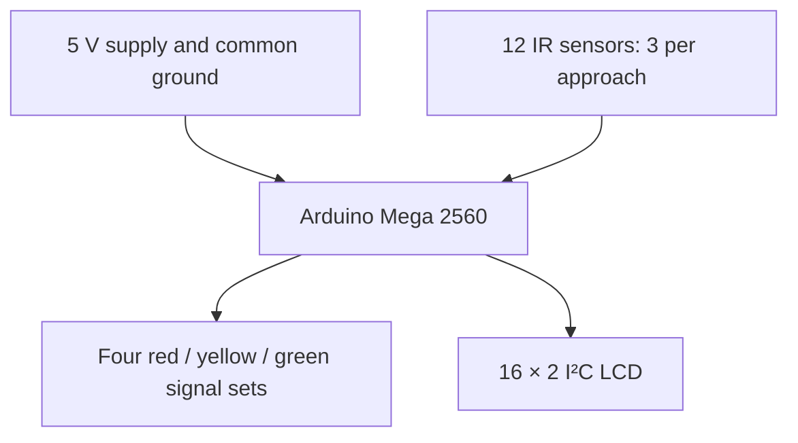

# 🚦 Density Based Traffic Light Control System
**Adaptive 4-Way Traffic Signal Controller Using Arduino Mega and IR Sensors**


---

## 📖 Overview

The **Density Based Traffic Light Control System** is an adaptive traffic-management prototype designed to improve conventional fixed-time traffic signals.

The system monitors traffic density across four approaches:

- North
- South
- East
- West

Each road uses **3 IR sensing zones**, giving a total of **12 IR sensors**.

The Arduino Mega 2560 continuously monitors the sensors, estimates the traffic density of each road, assigns priority to the most congested approach, and dynamically adjusts the green-signal duration.

The system also provides live traffic information through a **16×2 I²C LCD display**.

---

## 📸 Project Image


---

## ✨ Features

- 🚦 4-Way Adaptive Traffic Signal Control
- 📡 12 IR Traffic Sensing Zones
- 🧠 Real-Time Traffic Density Estimation
- ⏱ Dynamic Green Signal Timing
- 🔴🟡🟢 Independent Red, Yellow and Green Signals
- 📟 16×2 I²C LCD Monitoring
- ⚖ Density-Based Traffic Priority
- 🔄 Fair Rotating Priority for Equal Traffic Density
- 🛑 All-Red Safety Interval
- 🟡 Yellow Transition Phase
- 🔍 Sensor Reading Stabilization
- 🚘 Sensor Activation Order Independent
- ♻ Continuous Automatic Operation
- ✅ Only One Direction Receives Green at a Time

---

## System Architecture



The sensor modules and LCD share the regulated supply and common ground. Each traffic LED uses its own current-limiting resistor.

---

## Traffic Density Logic

Traffic density is estimated using the **number of active IR sensing zones**.

The sensor activation order does not matter. In the patterns below, `1` means **detected** and `0` means **clear**, after converting the active-low electrical input. These are logical detection states, not raw pin voltage levels.

| Active Sensors | Example Patterns | Traffic Density | Green Time |
|---|---|---|---:|
| 0 | `000` | Empty | No Green Request |
| 1 | `100`, `010`, `001` | Low | 7 Seconds |
| 2 | `110`, `101`, `011` | Medium | 10 Seconds |
| 3 | `111` | High | 15 Seconds |

Example:

```text
North Sensor State = 101
```

Two sensors are active, therefore:

```text
Traffic Density = MEDIUM
Green Time = 10 Seconds
```

---

## Signal Timing

| Signal Condition | Duration |
|---|---:|
| Low Density Green | 7 Seconds |
| Medium Density Green | 10 Seconds |
| High Density Green | 15 Seconds |
| Yellow Signal | 3 Seconds |
| All-Red Safety Interval | 1 Second |

Signal transition:

**Green (7 / 10 / 15 s) → Yellow (3 s) → All red (1 s) → Next eligible road.**

---

## Hardware Used

| Component | Quantity |
|---|---:|
| Arduino Mega 2560 | 1 |
| IR Obstacle Sensor Modules | 12 |
| Red LEDs | 4 |
| Yellow LEDs | 4 |
| Green LEDs | 4 |
| 220Ω / 330Ω Resistors | 12 |
| 16×2 I²C LCD Display | 1 |
| Breadboard | As Required |
| Jumper Wires | As Required |
| 5V / 2A Power Supply | 1 |
| Toy Vehicles | As Required |
| Project Base Board | 1 |

---

## Pin Configuration

### IR Sensors

| Direction | IR1 | IR2 | IR3 |
|---|---:|---:|---:|
| North | 22 | 23 | 24 |
| South | 25 | 26 | 27 |
| East | 28 | 29 | 30 |
| West | 31 | 32 | 33 |

Each IR sensor:

```text
VCC → 5V
GND → GND
OUT → Assigned Arduino Pin
```

The sensors used in this prototype are active-low:

```text
LOW  = Object Detected
HIGH = No Object
```

---

### Traffic Signal LEDs

| Direction | Red | Yellow | Green |
|---|---:|---:|---:|
| North | 34 | 35 | 36 |
| South | 37 | 38 | 39 |
| East | 40 | 41 | 42 |
| West | 43 | 44 | 45 |

LED connection:

Connect each output pin through a **220 Ω or 330 Ω resistor** to the LED anode; connect the cathode to GND.

---

### LCD Connection

| LCD Pin | Arduino Mega |
|---|---|
| VCC | 5V |
| GND | GND |
| SDA | Pin 20 |
| SCL | Pin 21 |

I²C address used:

```text
0x27
```

---

## Software & Technologies

- Arduino IDE
- Embedded C / C++
- Arduino Mega 2560
- Digital I/O
- I²C Communication
- Finite State Machine
- Priority Scheduling
- Adaptive Timing
- IR Sensor Interfacing
- LCD Interface

---

## Libraries Used

```cpp
#include <Wire.h>
#include <LiquidCrystal_I2C.h>
```

The `Wire` library is supplied with the Arduino board core. The reported implementation also uses the standard `<string.h>` header for fixed-width LCD text.

Install the `LiquidCrystal_I2C` library using the Arduino Library Manager.

---

## Setup and Operation

1. Wire the sensors, LEDs and LCD according to the pin tables, with a common ground.
2. Open the project firmware (`.ino`) in Arduino IDE and select **Arduino Mega or Mega 2560** and the connected port.
3. Install the `LiquidCrystal_I2C` implementation compatible with the sketch. Confirm the LCD address matches the configured `0x27`.
4. Compile and upload the firmware. Open Serial Monitor at **9600 baud** for the reported diagnostic output.
5. Calibrate each IR module using a toy vehicle in its sensing zone. Verify all 12 sensors independently.
6. Test `000`, single-zone, two-zone and `111` patterns, then test mixed traffic across all four roads.
7. Confirm that only the selected approach is green and that each transition includes yellow and all red.

## Working Principle

The system continuously reads all 12 IR sensors.

For each road, the number of active sensors is calculated.

```text
0 Sensors → EMPTY
1 Sensor  → LOW
2 Sensors → MEDIUM
3 Sensors → HIGH
```

At the start of each service cycle, the controller copies the latest densities into `cycleDensity[]` and clears the `served[]` flags. It selects the highest-density **unserved** road from this snapshot. Sensors and the LCD continue updating while the signal state machine runs.

Priority:

```text
HIGH > MEDIUM > LOW > EMPTY
```

The selected road receives a green signal according to its density.

After the green period:

```text
Green
  ↓
Yellow for 3 Seconds
  ↓
All Red for 1 Second
  ↓
Next Road
```

Each road occupied in the cycle snapshot receives one turn. After all eligible roads are served, the controller captures a new snapshot. New traffic is therefore considered in the next service cycle; live readings do not continuously reorder the current cycle.

---

## Priority Logic

Example traffic condition:

```text
North = HIGH
South = LOW
East  = MEDIUM
West  = EMPTY
```

Expected priority:

```text
North
  ↓
East
  ↓
South
```

Corresponding timing:

```text
North  → Green 15 Seconds
East   → Green 10 Seconds
South  → Green 7 Seconds
```

West is skipped because no traffic is detected.

---

## Equal Density Handling

If multiple roads have the same density, the controller uses a **rotating priority system**.

Example:

```text
North = HIGH
South = HIGH
East  = HIGH
West  = HIGH
```

Example service sequence, when the rotating search starts at North:

```text
North
  ↓
South
  ↓
East
  ↓
West
```

Tie selection begins immediately after `lastServed` in the configured North–South–East–West order. The starting road therefore depends on the previous selection; North is not always first. The next complete cycle evaluates the latest sensor conditions.

This prevents one road from repeatedly receiving priority while other occupied roads are waiting.

---

## Sensor Filtering

IR sensors can occasionally generate unstable readings due to:

- Object reflectivity
- Sensor alignment
- Electrical noise
- Environmental lighting

To improve reliability, each IR sensor is sampled multiple times.

```text
Samples per Reading = 7
```

The sensor is considered active when at least:

```text
4 out of 7 readings
```

detect an object.

This majority-voting method improves stability during operation.

---

## LCD Monitoring

The 16×2 I²C LCD provides live traffic information.

### Overall Density

```text
N:H S:L E:M W:0
N GREEN 15s
```

Where:

```text
H = High
M = Medium
L = Low
0 = Empty
```

### Detailed Sensor Status

Example:

```text
N:101 MED
S:001 LOW
```

and:

```text
E:110 MED
W:111 HIGH
```

The display therefore shows:

- Traffic density
- Filtered detection patterns
- Active road
- Current signal phase
- Remaining signal time

---

## Project Workflow

1. Initialize the Mega, inputs, outputs and LCD; set all signals red.
2. Read and filter the 12 sensors, then calculate live densities.
3. At the start of a service cycle, capture the density snapshot and clear served flags.
4. If every road is empty, keep all signals red and continue scanning.
5. Select the highest-density unserved road, resolving ties after `lastServed`.
6. Apply its 7, 10 or 15-second green phase, followed by 3 seconds yellow and 1 second all red.
7. Mark the road served and select the next eligible road from the same snapshot.
8. Once the cycle is complete, capture a fresh snapshot and repeat.

Signal phases use a `millis()`-based state machine so sensing and display updates can continue during each phase.

---

## Experimental Results

The project report records the following prototype test results. These are reported hardware results, not tests performed as part of this README revision.

| Test | Result |
|---|---|
| North Traffic Detection | ✅ Passed |
| South Traffic Detection | ✅ Passed |
| East Traffic Detection | ✅ Passed |
| West Traffic Detection | ✅ Passed |
| 12 IR Sensor Operation | ✅ Passed |
| Low Density Detection | ✅ Passed |
| Medium Density Detection | ✅ Passed |
| High Density Detection | ✅ Passed |
| Sensor Order Independence | ✅ Passed |
| Adaptive Green Timing | ✅ Passed |
| Yellow Transition | ✅ Passed |
| All-Red Safety Interval | ✅ Passed |
| Density Priority | ✅ Passed |
| Equal Density Rotation | ✅ Passed |
| LCD Live Monitoring | ✅ Passed |
| One Green Direction at a Time | ✅ Passed |
| Continuous Operation | ✅ Passed |

---

## Demonstration Scenario

One of the main test cases:

```text
North = HIGH
South = LOW
East  = MEDIUM
West  = EMPTY
```

The controller responds as:

```text
North Green 15s
      ↓
North Yellow 3s
      ↓
All Red 1s
      ↓
East Green 10s
      ↓
East Yellow 3s
      ↓
All Red 1s
      ↓
South Green 7s
```

This demonstrates the adaptive nature of the controller.

---

## 🎥 Demonstration Video

[▶ Watch the project demonstration on YouTube](https://youtu.be/rHp44wBV4Nk)

The video demonstrates:

- Empty traffic condition
- Low traffic density
- Medium traffic density
- High traffic density
- Mixed traffic conditions
- Priority selection
- Adaptive signal timing
- Yellow transition
- All-red safety interval
- LCD monitoring

---

## Applications

- Smart Traffic Management
- Adaptive Traffic Signal Systems
- Smart City Research
- Embedded Systems Education
- Engineering Mini Projects
- Traffic Management Demonstrations
- Intelligent Transportation Research
- Arduino-Based Control Systems

---

## Advantages

- Adaptive signal timing
- Simple hardware architecture
- Low-cost implementation
- Real-time traffic-density estimation
- Automatic priority control
- Fair equal-density scheduling
- Clear LCD monitoring
- Reduced unnecessary green time
- Modular design
- Easy to demonstrate and modify

---

## Limitations

- Educational scale-model prototype; not a certified road traffic controller
- Scheduling uses a per-cycle snapshot, so new traffic can wait until the next cycle
- IR sensors estimate sensing-zone occupancy rather than exact vehicle count
- IR sensors may be affected by environmental conditions
- Prototype uses simplified one-direction-at-a-time control
- No emergency vehicle priority
- No pedestrian crossing system
- No cloud monitoring
- No camera-based vehicle classification

---

## Future Scope

- 📷 Camera-Based Traffic Detection
- 🤖 AI Traffic Density Estimation
- 🚑 Emergency Vehicle Priority
- 🚶 Pedestrian Signal Control
- 🌐 IoT-Based Remote Monitoring
- ☁ Cloud Dashboard
- 📊 Traffic Data Logging
- 📱 Mobile Application
- 🧠 Machine Learning Traffic Prediction
- 🚘 Vehicle Counting and Classification
- 🌙 Day/Night Adaptive Operation
- 🗺 Multi-Intersection Coordination
- 🔋 Solar-Powered Traffic Control

---

## Author

**Eshwar Prasad Y**

Electronics & Communication Engineering

Embedded Systems | IoT | Automotive Electronics | Arduino | Microcontrollers

Email: [eshwargowda313@gmail.com](mailto:eshwargowda313@gmail.com)

LinkedIn: [Eshwar Prasad Y](https://www.linkedin.com/in/eshwar-prasad-y-a3043b370/)

---

## Acknowledgements

Special thanks to:

- Arduino Community
- Open Source Hardware Community
- Embedded Systems Community
- Developers and contributors of the LiquidCrystal_I2C library

---

## Project Status

```text
✅ Hardware Completed
✅ Software Completed
✅ Sensor Testing Completed
✅ Four-Way Integration Completed
✅ LCD Integration Completed
✅ Adaptive Priority Logic Completed
✅ Working Prototype Demonstrated
```

---

## ⭐ Support

If you find this project useful, consider giving the repository a **Star ⭐**.

Feel free to fork the repository and extend the system with IoT, AI, camera-based traffic detection, emergency vehicle priority, or smart-city connectivity.

---

### 🚦 Density Based Traffic Light Control System

**Arduino Mega 2560 | 12 IR Sensors | 4-Way Adaptive Traffic Control | Real-Time LCD Monitoring**
